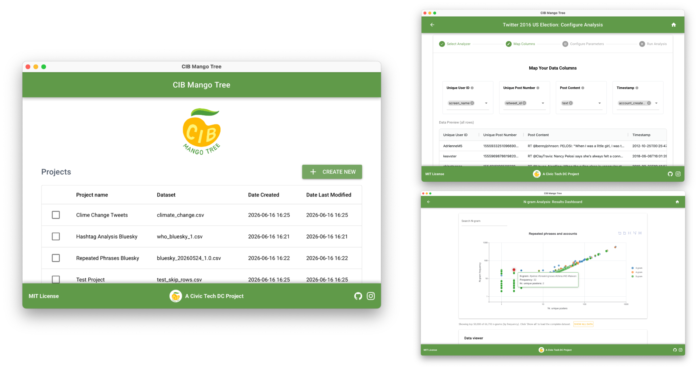

<h1 align="center">CIB Mango Tree</h1>

<h3 align="center">An Open Source Toolkit for Detecting Coordinated Inauthentic Behavior in Datasets of Online Activity</h3>

**Quick start:** [Try in Codespaces](#try-in-github-codespaces) · [Download a release](#download-latest-release) · [Contribute](#contributing)

## About

CIB Mango Tree is a Python-based, interactive open source toolkit for detecting coordinated inauthentic behavior (CIB) in social media datasets. It is designed for researchers, data journalists, fact-checkers, and watchdogs working to identify inauthentic activity online. For more about the project, visit the project main home page: [cibmangotree.org](https://cibmangotree.org)

CIB Mango Tree is a project of [Civic Tech DC](https://www.civictechdc.org/), a nonprofit community of volunteers using open-source technology to support civic engagement, strengthen democracy, and empower public-interest initiatives.

## Download latest release

The latest release is available under Assets in the Releases tab: 
  
[CIB Mango Tree latest](https://github.com/civictechdc/cib-mango-tree/releases/latest)

> [!NOTE]
> Starting with **v0.11.0** we have new GUI interface! 
> 
> The last version to use the terminal user interface (CLI) was v0.10.2

## Try in GitHub Codespaces

No local install needed (sign in to GitHub first — Codespaces requires a GitHub account):

1. Click the badge above and create a Codespace.
2. Wait for setup. The **first** open often takes several minutes (dependency install). That is normal — it is not frozen. The terminal will show progress; setup is done when you see: `CIB Mango Tree is ready — open port 8000 in the browser if it did not open automatically.`
3. A browser tab may open with a “starting…” page first; it refreshes until the app is ready.
4. When ready, CIB Mango Tree appears in the browser (port 8000). You do not need to run terminal commands.

If the app does not open automatically, open the **Ports** tab in the bottom panel (same area as **Terminal**), find port **8000**, and click the globe icon to open it in the browser.

Later opens of the same Codespace are usually much faster.

To use the app, download a [sample data file](assets/demo_data/demo_data.csv). In the app, click **Create New** on the start page, then click **Browse Files** to upload that file.

## Contributing

New contributions are welcome! Before contributing, please check out our [Technical Documentation guides](https://civictechdc.github.io/cib-mango-tree). If you are not yet familiar with the project, our [New Contributor Guide](https://civictechdc.github.io/cib-mango-tree/guides/contributing/new_contributor_guide) is the best place to start. You can also [join Civic Tech DC on Slack](https://www.civictechdc.org/slack) and look for the `#cib-mango-tree-*` channels.

### Installing development version

If you are already familiar with the bigger picture, head over to the [Installation guide](https://civictechdc.github.io/cib-mango-tree/guides/get-started/installation/) in our docs to see how to setup your development environment.

### Styling

The [Styling Guide](https://civictechdc.github.io/cib-mango-tree/guides/contributing/styling) is for contributors working on the application's frontend. Its goal is to keep frontend contributions consistent and easier to understand and maintain as the project evolves.

### UX

Design and research handoff (personas, journeys, screen exports) lives in the [`ux/`](ux/) folder. Start with the [UX README](ux/README.md) for layout, conventions, and how assets move into the product or docs.

### Datasets (Testing)

Known datasets for research, prototyping, and QA live in a shared [Google Drive folder](https://drive.google.com/drive/folders/1OL7toRas_JbCw5nSMbbWb7j6yZciO5r5). Smaller fixtures tracked in the repo are documented under [`assets/test_data/`](assets/test_data/README.md).

### Planned analyzers / tests

Test outlines, backlog, and roadmap for analyzers planned or in progress live in a shared [Google Drive folder](https://drive.google.com/drive/folders/1xm0v5Wo8IuyBcdW_5h8RousgjY4dyVJ5).

## Maintainers

Cutting a release? Use the **[Release Checklist](https://github.com/civictechdc/cib-mango-tree/wiki/Release-Checklist)** on the project wiki.

## AI policy

Contributors using AI tools should follow the project [AI Use Policy](AI_POLICY.md).

## License

This project is licensed under the [MIT License](https://opensource.org/license/mit).

### Required Notice

Required Notice: © [CIB Mango Tree](https://cibmangotree.org)
