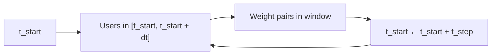
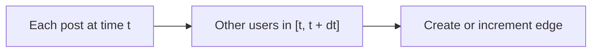

# Time Coordination methods

Academic background for the **Time Coordination** analyzer: four approaches to scoring posting-time overlap between accounts. Notes and commentary were provided by [John Biddle](https://github.com/johnbiddle). This page is method background, not a usage guide for the GUI.

## At a glance

| Method | In the app? | Relative speed | Takeaway |
| --- | --- | --- | --- |
| [1. Sliding window](#method-1-sliding-window) | Yes — *Sliding Window* | Often slowest of the three shipped options on long timelines | Fixed windows slide across time; step size controls overlap |
| [2. Action Driven Overlapping Window](#method-2-action-driven-overlapping-window) | Yes — *Action Driven Overlapping Window* | Often faster than Method 1; results differ | Windows anchored on each post, not on a time grid |
| [3. Time overlap](#method-3-time-overlap) | Yes — *Time Overlap* *(default)* | Depends on user count, span, and bin coarseness | Compares binned activity signals; can be slow if not coarsened |
| [4. Dynamic Time Warping](#method-4-dynamic-time-warping) | No | Very slow | Fewer false alarms in practice; not shipped |

## Parameters in the app

In the GUI these map to analyzer params (defaults in parentheses):

| Param | UI label | Role |
| --- | --- | --- |
| `method` | Method | Which algorithm to run (default: Time Overlap) |
| `win_size` | Window size (steps) | Number of time steps in a window (default: 2) |
| `t_step` | Time step (seconds) | Seconds per step (default: 300) |
| `min_posts` | Min posts (Time Overlap) | Drop accounts below this post count; Time Overlap only (default: 20) |

Window length in seconds is $\mathrm{win\_size} \times t_{\mathrm{step}}$. In the literature below, that length is often written $dt$; the slide increment is $t_{step}$. Smaller `t_step` (or Sliding Window on a long timeline) can be much slower.

## Method 1: Sliding window

*References: [[1]](#ref-1), [[2]](#ref-2), [[4]](#ref-4), [[5]](#ref-5)*

Pick a window size $dt$ (for example 1, 2, or 5 minutes) and a step size $t_{step}$ (for example 1 second). For a start time $t_{start}$, identify all users who posted in $[t_{start},\, t_{end}]$ where $t_{end} = t_{start} + dt$, and add a weight to each pair of users in that group. The weight is either 1, or normalized by the number of posts in the window (to deemphasize busy windows and reduce false positives). Then slide the reference point by $t_{step}$ ($t_{start} \rightarrow t_{start} + t_{step}$) and repeat.

The difference between “adjacent” and “evenly distributed overlapping” windows in Table 4 of [[4]](#ref-4) is the choice of step size.

## Method 2: Action Driven Overlapping Window

*References: [[1]](#ref-1), [[2]](#ref-2), [[4]](#ref-4), [[5]](#ref-5)*

Iterate through each post, then examine users who posted within $dt$ of that post. Create an edge of weight 1, or add 1 to an existing edge. Optionally normalize by the number of posts in the window, or multiply by how often the second user posted in that window. It is “action driven” because the search is anchored on posts rather than on fixed time steps as in Method 1.

This method often appears faster than Method 1, but the results differ.

!!! tip "Method 1 vs Method 2"
    Method 1 walks a **time grid**. Method 2 walks **posts**. Same idea (co-activity inside a window of length $dt$), different enumeration—and often different graphs and runtimes.

## Method 3: Time overlap

*Origin: developed for this workstream (not from the survey literature above).*

Computes a correlation-like overlap of posting-time patterns between two users. To allow a time window, one user’s time signal is convolved with a rectangular window of width $2\,dt$ (a triangular window may also be useful). The overlap is the dot product of the two signals.

Runtime depends on the number of unique users, the time span of the CSV, and how coarse the time signals are. Without coarsening (decimation), it can be impractically slow on some datasets.

!!! warning
    This method is not necessarily more robust or faster than Methods 1 and 2. Edge weights can likely be improved further.

## Method 4: Dynamic Time Warping

*Reference: [[3]](#ref-3); implementation notes rely on [[6]](#ref-6).*

Similar in spirit to Method 3, but uses dynamic time warping (DTW) so similarity can tolerate distortion between posting patterns—effectively a dynamic time-window separation.

!!! note
    One implementation path uses the optimizations in [[6]](#ref-6), which need a C-based routine and Cython. More portable alternatives likely exist.

In practice this approach tends to find pairs with very similar posting patterns and appears to produce fewer false alarms. Awareness so far is mainly from [[3]](#ref-3); more recent work usually uses a variant of Method 1 or 2.

!!! warning
    DTW is **slow**, and is likely not worth shipping unless further optimizations are found. It is not offered in the current Time Coordination UI.

## References

This list illustrates the methods above; it is not exhaustive for a publication.

1. Magelinski, T., Ng, L. H. X., & Carley, K. M. (2021). A Synchronized Action Framework for Responsible Detection of Coordination on Social Media. arXiv preprint [arXiv:2105.07454](https://arxiv.org/abs/2105.07454).
2. Lynnette H. X. Ng and Kathleen M. Carley. 2022. Online coordination: Methods and comparative case studies of coordinated groups across four events in the United States. In *ACM WebSci*. 12–21.
3. N. Chavoshi, H. Hamooni and A. Mueen, "DeBot: Twitter Bot Detection via Warped Correlation," 2016 IEEE 16th International Conference on Data Mining (ICDM), Barcelona, Spain, 2016, pp. 817-822, [doi:10.1109/ICDM.2016.0096](https://doi.org/10.1109/ICDM.2016.0096).
4. Mannocci, Lorenzo, et al. "Detection and characterization of coordinated online behavior: A survey." arXiv preprint [arXiv:2408.01257](https://arxiv.org/abs/2408.01257) (2024).
5. Yu, William Emmanuel. (2022). A Framework for Studying Coordinated Behaviour Applied to the 2019 Philippine Midterm Elections. [doi:10.1007/978-981-16-2380-6_63](https://doi.org/10.1007/978-981-16-2380-6_63).
6. Wannes Meert, Kilian Hendrickx, Toon Van Craenendonck, Pieter Robberechts, Hendrik Blockeel & Jesse Davis. DTAIDistance (Version v2). Zenodo. [doi:10.5281/zenodo.5901139](https://doi.org/10.5281/zenodo.5901139).

## See also

- Implementing analyzers (recipe, registration, dashboards): [Analyzers](../contributing/analyzers.md)
- In-repo Time Coordination fold and params: [`src/cibmangotree/analyzers/time_coordination/README.md`](https://github.com/civictechdc/cib-mango-tree/blob/main/src/cibmangotree/analyzers/time_coordination/README.md)
