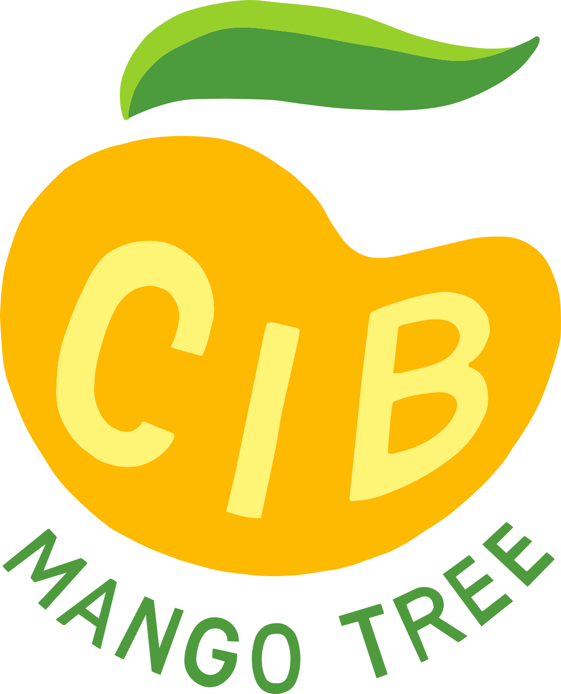

# Technical documentation

Welcome to the technical documentation website of [CIB Mango Tree](https://cibmangotree.org), a collaborative and open-source project to develop software that tests for coordinated inauthentic behavior (CIB) in datasets of social media activity.

This is the technical documentation, for a user-based perspective see the project main home page: [cibmangotree.org](https://cibmangotree.org)

**Known datasets** for research, prototyping, and QA live in a shared [Google Drive folder](https://drive.google.com/drive/folders/1OL7toRas_JbCw5nSMbbWb7j6yZciO5r5). Smaller fixtures tracked in the repo are under [`assets/test_data/`](https://github.com/civictechdc/cib-mango-tree/tree/main/assets/test_data).
